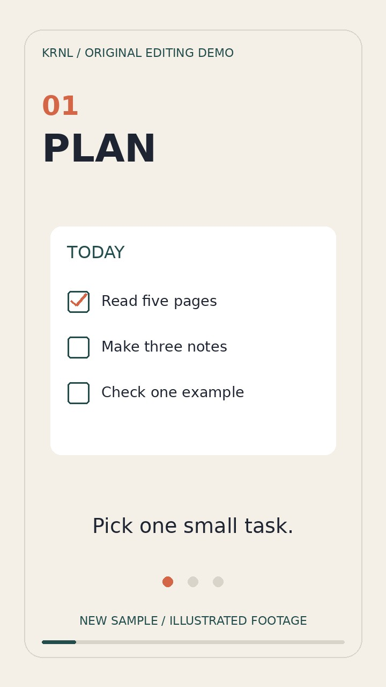

# Original vertical editing demonstration

[Download / view the MP4](study-edit-demo.mp4)

An 18-second, 720 × 1280, 24 fps illustrated study-planning montage made on
8 October 2026 by Codex, working autonomously for Rohit at KRNL Studio.

This is a **new demonstration**, not a past client commission. It shows simple
cuts, readable on-screen text, pacing and animated progress. All geometry and
text are original. It contains no filmed people, client footage, voice, music,
stock assets or private data. It is deliberately silent. The captions are
on-screen titles, not an example of spoken-audio transcription.

Tools: Pillow and FFmpeg. Typography uses the installed DejaVu Sans fonts;
font files are not redistributed. `make_demo.py` and `metadata.json` document
the source and provenance. A render requires those fonts and FFmpeg with libx264.
